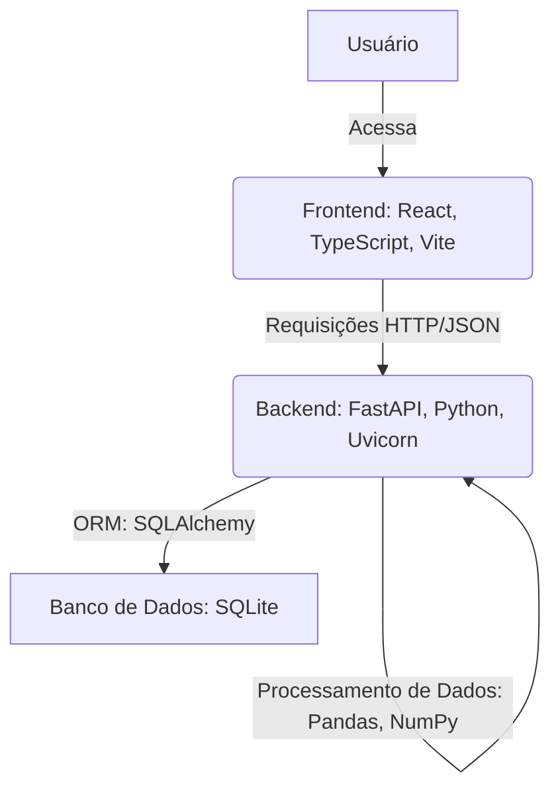

# Análise da Pilha Tecnológica e Conexão Frontend-Backend

## Tecnologias Frontend

-   **Framework:** React
-   **Linguagem:** TypeScript
-   **Ferramenta de Build:** Vite
-   **Estilização:** Tailwind CSS, PostCSS, Radix UI, shadcn/ui
-   **Roteamento:** React Router DOM
-   **Gerenciamento de Estado/Busca de Dados:** TanStack Query
-   **Tratamento de Formulários e Validação:** React Hook Form, Zod

## Tecnologias Backend

-   **Framework:** FastAPI
-   **Servidor ASGI:** Uvicorn
-   **Linguagem:** Python
-   **ORM (Object-Relational Mapper):** SQLAlchemy
-   **Banco de Dados:** SQLite (com planos futuros para PostgreSQL)
-   **Validação de Dados:** Pydantic
-   **Gerenciamento de Variáveis de Ambiente:** python-dotenv
-   **Bibliotecas de Processamento de Dados:** Pandas, NumPy
-   **Ferramenta de Migração de Banco de Dados:** Alembic

## Conexão Frontend-Backend

O frontend se comunica com o backend através de requisições HTTP, utilizando as seguintes características:

-   **Cliente API:** O frontend utiliza a API nativa `fetch` do navegador, encapsulada em uma função auxiliar [`fetchApi()`](src/services/api.ts:12) para padronizar as requisições.
-   **URL Base da API:** A URL base para as requisições API é definida pela variável de ambiente `VITE_API_URL`. Se não for definida, o padrão é [`http://localhost:8000/api/v1`](src/services/api.ts:9).
-   **Formato de Dados:** A comunicação entre frontend e backend é realizada utilizando o formato JSON para envio e recebimento de dados.
-   **Padrão de Interação da API:** As interações seguem um padrão RESTful, com endpoints bem definidos para diferentes recursos (e.g., `/orders/`, `/financeiro/`, `/customers/`).
-   **Transformação de Dados:** Existem funções auxiliares, como [`convertEntryToCamelCase()`](src/services/api.ts:142) e [`convertEntryToSnakeCase()`](src/services/api.ts:190), para converter os casos das chaves dos objetos (snake_case no Python backend para camelCase no TypeScript/JavaScript frontend e vice-versa), garantindo compatibilidade entre as duas camadas.

## Diagrama de Arquitetura Simplificado



## Próximos Passos (TODO List)

```markdown
## Project Technology Overview

### Frontend Technologies
- [x] Identify frontend framework: React
- [x] Identify frontend language: TypeScript
- [x] Identify build tool: Vite
- [x] Identify styling frameworks: Tailwind CSS, PostCSS, Radix UI, shadcn/ui
- [x] Identify routing library: React Router DOM
- [x] Identify state management/data fetching: TanStack Query
- [x] Identify form handling and validation: React Hook Form, Zod

### Backend Technologies
- [x] Identify backend framework: FastAPI
- [x] Identify ASGI server: Uvicorn
- [x] Identify backend language: Python
- [x] Identify ORM: SQLAlchemy
- [x] Identify database: SQLite (with future PostgreSQL plans)
- [x] Identify data validation: Pydantic
- [x] Identify environment variable management: python-dotenv
- [x] Identify data processing libraries: Pandas, NumPy
- [x] Identify database migration tool: Alembic

### Frontend-Backend Connection
- [x] Identify API client: Native `fetch` API
- [x] Determine base API URL: `VITE_API_URL` (defaults to `http://localhost:8000/api/v1`)
- [x] Identify data format: JSON
- [x] Describe API interaction pattern: RESTful endpoints
- [x] Note data transformation: snake_case (backend) to camelCase (frontend) conversion
```

Por favor, me informe se há algo que você gostaria de mudar ou adicionar a este plano.